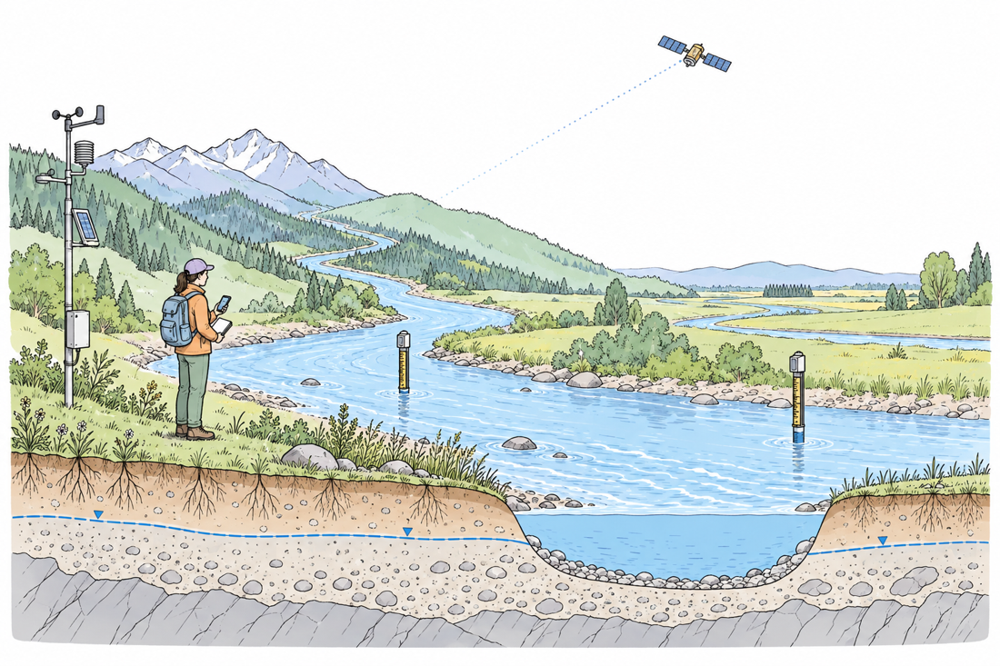

# 自然手绘科研配图

[English](README.md)

把自然的手绘科研风格固定成一套可复用提示词和 skill。适合论文方法图、研究场景、机制示意、技术路径，以及科研 PPT 配图。



## 最快用法

**Codex**

```sh
git clone https://github.com/Yang1107-wzy/handdrawn-scientific-figures.git
cd handdrawn-scientific-figures
python -m pip install -r requirements.txt
python scripts/install.py --client codex
python scripts/install.py --client codex --apply
```

第一条安装命令预览，第二条复制完整 skill。之后在 Codex 输入：

```text
请使用 $handdrawn-scientific-figures，根据这份方法描述画论文方法图。保留真实模块、公式和反馈关系，输出 PNG、PDF、SVG 与可编辑标注。
```

**Claude Code**

把安装参数换成 `--client claude`，使用：

```text
/handdrawn-scientific-figures 根据这些材料画一张 16:9 科研场景图，采用固定手绘风格。
```

安装器不会覆盖已有 skill，不会安装 AI 客户端、模型或修改配置。新会话中仍找不到时，检查客户端的 skill 加载位置。当前官方路径参考：[Codex](https://learn.chatgpt.com/docs/build-skills)、[Claude Code](https://code.claude.com/docs/en/skills)。

**GPT / Claude 聊天界面**

打开 [完整总提示词](skills/handdrawn-scientific-figures/references/master-prompt.md)，复制英文提示词，只替换内容简报。保持字体、色板、线条和准确性规则不变。[四类构图模板](skills/handdrawn-scientific-figures/references/figure-templates.md) 可分别用于场景、方法、机制与数据组合图。

如果要在 PowerPoint 中保持原生手写字体，请先安装包内 Kalam-Bold.ttf 和 PatrickHand-Regular.ttf：macOS 打开字体文件并在字体册中安装，Windows 使用字体文件的安装命令。Python 合成器直接读取随包字体，PNG／PDF／SVG 不依赖系统安装。

## 固定什么，改变什么

固定纯白背景、炭黑笔触、轻微自然的不规则轮廓、五种柔和色彩，以及 Kalam Bold 标题、Patrick Hand 批注和规整数值字体。

每次根据研究内容改变构图：方法用真实关系组织，场景围绕环境实体展开，机制采用剖面或空间关系，数据图保持真实坐标与统计口径。不会把所有图套成同尺寸卡片，也不会添加无关机器人。

论文默认宽 180 mm、300 dpi，导出 PNG／PDF／SVG；PPT 默认 16:9、3840×2160，额外交付可编辑文字与连接线的 PPTX 单页。期刊指定尺寸优先。

## 示例与重建

- [方法图](examples/method/figure.png)：双输入、估计、精确高度公式、质量检查与反馈。
- [场景图](examples/scene/figure.png)：河流、现场观测与遥感的概念场景。
- [插画与数据组合图](examples/hybrid/figure.png)：传感器插画，加明确标注的教学合成信号；不代表科研实验。

```sh
python examples/build_examples.py
python scripts/validate.py
python -m unittest discover -s tests -v
python scripts/package.py --output dist/handdrawn-scientific-figures.zip
python scripts/package.py --skill-only --output dist/handdrawn-scientific-figures-skill.zip
```

[图层配置说明](skills/handdrawn-scientific-figures/references/composition.md) 给出精确标签、公式和连接线的编辑方式。修改已生成输出时需明确使用 `--overwrite`；示例重建脚本只更新自己的生成结果。

SVG／PDF 内的插画仍是位图，文字和连接线保留矢量；数据图另有独立 SVG／PDF。PPTX 的文字和连接线可编辑，公式作为图像插入；在其他电脑展示时需安装附带字体。生成图像需要环境中实际可用的图像工具，skill 本身不提供模型。Claude 可处理 SVG、图表和布局，栅格手绘插画需要图像工具。[Claude 官方说明](https://support.claude.com/en/articles/9002504-can-claude-produce-images)。

公开包只包含通用提示词、代码、字体许可和原创概念示例，不包含参考博主截图、个人申请资料或未发表研究数据。详情见 [来源记录](SOURCES.md) 和 [行为测试](evaluations/README.md)。
